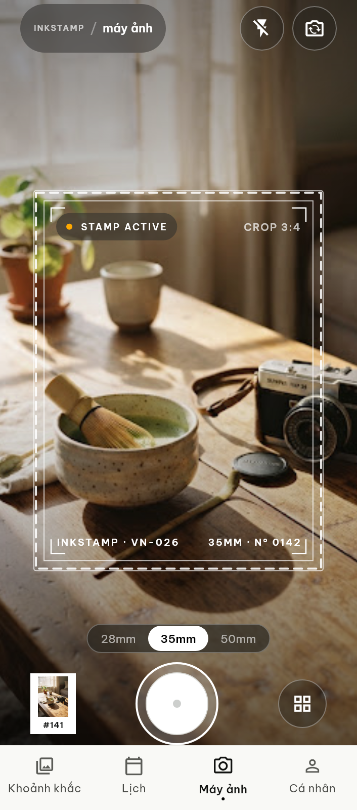
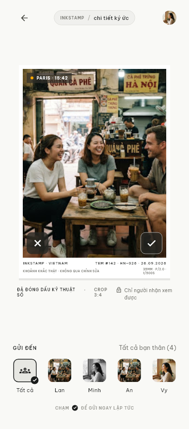

# InkStamp

A camera-first Android app that turns small moments into stamp-style photos, shared with selected friends and revisited by date.

**Flutter/Dart · Riverpod · GoRouter · Firebase · Cloudinary · Cloudflare Worker**

**Verified DEV:** 130 Flutter tests; real A/B send/receive and sample-photo E2E; Camera stress PASS.
**Google Sign-In E2E: DEFERRED · Production: NOT READY.**

  
  

Unmodified Flutter widget-test renders with fixture data—not live-camera screenshots. [Media provenance](docs/portfolio/MEDIA_INDEX.md).

## Demo

Start with the [two-minute overview](docs/PORTFOLIO_OVERVIEW.md) or [recruiter walkthrough](docs/RECRUITER_DEMO.md).

The current **debug DEV APK** is built at `apps/mobile/build/app/outputs/flutter-apk/app-debug.apk`. It is Git-ignored, not a public download or standalone production build. Sharing requires local Functions/gateway services, real DEV Firebase/Cloudinary access and privately configured A/B passwords.

Prepared-workstation flow: start backend → launch DEV app → Test A captures/sends → Test B opens Inbox/Calendar. [Exact run steps](#running-the-demo).

Debug DEV also supports personal sample captures from `apps/mobile/assets/image_test/` through a small Camera picker; it reuses real processing/sharing and is disabled outside debug DEV. [Usage and privacy boundary](docs/DEV_SAMPLE_CAPTURE.md).

## Core Features

- Native capture; 1440×1440 stamp-shaped PNG + 512×512 alpha thumbnail, orientation correction and EXIF removal. [Baked edges and compatibility](docs/STAMP_EDGES.md).
- One-screen Post-Capture: stamp preview, audience selection, progress/retry and discard.
- Friend Graph: username search, requests, accept/reject, Close Friends and block/unblock.
- Custom/ALL sharing, authorized media, Inbox unread/read and Calendar memories.
- Stable send identity/transactional retry; sender revoke with documented limits; guarded DEV-auth.

## Main User Flow

~~~mermaid
flowchart LR
  Camera --> Capture --> Preview --> Audience --> Send --> Inbox
  Inbox --> Detail
  Inbox --> Calendar
~~~

Preview/audience/send are logical steps on one screen, not separate editor pages.

## Screenshots

| Screen | Visual | Source / caveat |
|---|---|---|
| Camera | [Camera](docs/portfolio/screenshots/camera-golden.png) | Golden; sample preview |
| Post-Capture | [Preview/audience](docs/portfolio/screenshots/post-capture-golden.png) | Golden; fixture recipients |
| History | [Moments feed](docs/portfolio/screenshots/history-golden.png) | Golden; sample memories |
| Calendar | [Calendar](docs/portfolio/screenshots/calendar-golden.png) | Golden; [real DEV view](docs/portfolio/screenshots/calendar-dev-e2e.png) also available |
| Profile | [Collection](docs/portfolio/screenshots/profile-golden.png) | Golden; fixture identity/statistics |
| Inbox | [DEV Inbox](docs/portfolio/screenshots/inbox-dev-e2e.png) | Real E2E; visible pagination fixtures, not a polished hero |

Fully loaded real History/Profile/Memory Detail and before/after comparisons are available in the [photo-presentation report](docs/PHOTO_PRESENTATION.md). A short demo recording is still missing. Loading/error frames are not presented as finished media. [Complete inventory](docs/portfolio/MEDIA_INDEX.md).

## Tech Stack

| Area | Actually used |
|---|---|
| Mobile | Flutter/Dart, Riverpod, GoRouter, native CameraX via camera plugin |
| Images | Dart image library, app-private files, 1440/512 outputs, EXIF removal |
| Identity/data | Firebase Auth, Firestore, Security Rules and indexes |
| Business logic | TypeScript, callable Functions, Admin SDK, Zod; Functions Emulator for DEV |
| Media | Cloudflare Worker/Wrangler, Firebase JWT verification, authenticated Cloudinary |
| Tests | Flutter unit/widget/golden/integration tests, Vitest, Rules emulator, Android Emulator/ADB |

Push, iOS/Apple E2E and analytics are not demonstrated features. Dependencies/scaffolds alone are not completion claims.

## Architecture

Feature-first mobile code separates widgets, Riverpod orchestration, domain entities/repository contracts and SDK-backed data repositories. Controllers coordinate capture/drafts/publish/Inbox/Calendar; not every feature has a standalone use-case class.

Firebase Auth identifies callers. Local callable Functions run friendship/publish/revoke logic against **real DEV Firestore**, with explicit token verification. The Worker authorizes media and holds Cloudinary secrets, not the mobile app. Deliveries feed Inbox/Calendar.

[Architecture/flow diagrams](docs/PORTFOLIO_OVERVIEW.md#architecture) · [Detailed architecture](docs/ARCHITECTURE.md)

## Testing

Last verified 2026-10-11, including the photo-presentation regression. Suites overlap and are not aggregated.

| Suite | Result | Purpose |
|---|---|---|
| Flutter | 130/130 PASS | Unit/widget/visual regression |
| DEV-auth | 7/7 PASS | Flag-enabled guards/session isolation |
| Regression | 58/58 PASS | Camera/Post-Capture/upload/visual/archive subset |
| Rules | 7/7 PASS | Access-control denial |
| Pagination | 8/8 PASS | Timestamp/ID cursors and ties |
| Functions | 29/29 PASS | Business policies/idempotency |
| Gateway | 39/39 PASS | Authorization/App Check/error handling and PNG format support |
| Analyzer | Clean — 0 issues | Static checks |
| Golden | 5 PASS | Feed/Profile/Calendar deliberately updated; Camera/Preview unchanged |

DEV-auth/regression/golden overlap Flutter: **not additive totals**. Ordinary Functions testing skips 15 emulator-only cases, separately executed as Rules/pagination. [Stamp-edge checks](docs/STAMP_EDGES.md) · [Earlier photo evidence](docs/PHOTO_PRESENTATION.md) · [Earlier hardening evidence](docs/evidence/2026-10-10/release-hardening/result.md).

## E2E Coverage / Feature Status

“DONE” means implemented/verified in the documented **Android DEV** environment.

| Feature | Status | Notes |
|---|---|---|
| Camera/image processing | DONE | Real capture; 20 rapid transitions and background/Preview stress |
| Post-Capture | DONE | Preview/audience/send, cleanup and retry retention |
| Friend Graph | DONE (DEV routes) | Real A/B request/accept/reject/Close Friends; presenter route helper needed from current tab shell |
| Custom / ALL audience | DONE | Captured upload → publish → delivery |
| Inbox/read/Detail | DONE | Authorized lookup and unavailable states |
| Calendar | DONE | Local-date selection/shared Detail |
| Retry/idempotency | DONE | Real commit + lost response, no duplicate delivery |
| Block/unblock | DONE | Blocker-owned policy; no restoration of old deliveries |
| Revoke | DONE with limitations | Backend deletion/unavailable UI verified; no manual revoke button claimed |
| Google Sign-In E2E | DEFERRED | No real Google login run |
| Production release | NOT READY | Environment/signing/auth/link/smoke gates remain |

Earlier hardening A/B replay passed 1/1 in 5:52, requiring Wait on an emulator System UI ANR under host memory pressure. Later Camera stress and the latest photo replays passed without that intervention. Four sample photos were actually published; the 126 pagination fixtures are **not 126 real publishes**. These runs are not a production performance certification.

## Known Limitations

Full demo depends on local services and internet for real DEV Auth/Firestore/Cloudinary. Spark retained; no billing enabled or production Functions deployment. Google E2E, PROD signing/configuration, real App Links and production/R8 smoke remain unverified.

Current tabs do not expose a Friends launcher; the presenter uses existing authenticated URI routes described in the demo guide. Revoke has backend/E2E evidence, not a manual Detail-menu action. These are honest demo-navigation gaps, not newly implemented controls.

Revoke denies new authorization and attempts deletion, but cannot erase saved bytes/screenshots. Old bearer URLs/CDN caches, deletion failures and revoked delivery metadata have limits. Process-death drafts, physical-device/accessibility/performance audits and large-scale queries remain unverified. [Release boundaries](docs/RELEASE_HARDENING.md); earlier phase docs are historical.

## Running the Demo

Prerequisites: Flutter/Android SDK, booted dedicated emulator, Node 22, Firebase CLI, authorized `inkstamp-dev` access, local Firebase registration files, Cloudinary `.dev.vars` and private Test A/B passwords. A fresh clone is **not** credential-free five-minute setup; recruiters can view screenshots or a presenter-led session without admin access.

Prepare once, from repository root:

~~~powershell
npm --prefix functions ci
npm --prefix workers/media-gateway ci
cd apps/mobile
flutter pub get
cd ../..
~~~

Terminal 1, root:

~~~powershell
npm --prefix functions run build
$env:DEV_BACKEND_MODE='functions_emulator'
$env:MEDIA_GATEWAY_BASE_URL='http://127.0.0.1:8787'
firebase emulators:start --only functions --project inkstamp-dev
~~~

Terminal 2, root:

~~~powershell
cd workers/media-gateway
.\node_modules\.bin\wrangler.cmd dev --local --ip 127.0.0.1 --port 8787 --log-level warn --show-interactive-dev-session false
~~~

Terminal 3, root; verified device `emulator-5554`:

~~~powershell
adb -s emulator-5554 reverse tcp:5001 tcp:5001
adb -s emulator-5554 reverse tcp:8787 tcp:8787
cd apps/mobile
flutter run -d emulator-5554 --dart-define=APP_ENV=dev --dart-define=ENABLE_DEV_TEST_AUTH=true --dart-define=BACKEND_MODE=functions_emulator --dart-define=MEDIA_GATEWAY_BASE_URL=http://127.0.0.1:8787
~~~

Only Functions is emulated: Auth/Firestore affect the real DEV project. Do not rebuild Functions during a demo/E2E. No deploy or billing upgrade is part of these commands. [Setup files, APK install and account-switch guide](docs/RECRUITER_DEMO.md).

UI-only exploration from `apps/mobile`: `flutter run --dart-define=APP_ENV=dev --dart-define=DEMO_MODE=true` uses in-memory data, **not real sharing/E2E**.

## Project Structure

~~~text
apps/mobile/             Flutter app, tests and integration harnesses
functions/               Callable logic and DEV scripts
workers/media-gateway/   Authenticated media Worker
firebase/                Firestore indexes
firestore.rules          Client data-access boundaries
design_ui_ux/            Supplied HTML/PNG references
docs/portfolio/          Curated, source-labeled media/diagrams
docs/evidence/           Dated verification
~~~

## Documentation

[Portfolio Overview](docs/PORTFOLIO_OVERVIEW.md) · [Recruiter Demo](docs/RECRUITER_DEMO.md) · [CV Description](docs/CV_PROJECT_DESCRIPTION.md) · [Interview Notes](docs/INTERVIEW_NOTES.md) · [Media Index](docs/portfolio/MEDIA_INDEX.md)

Implementation history: [Interaction](docs/INTERACTION_PHASE.md), [Inbox/Calendar](docs/INBOX_CALENDAR_PHASE.md), [DEV Auth](docs/DEV_TEST_AUTH.md), [Backend DEV Unblock](docs/BACKEND_DEV_UNBLOCK.md), [Release Hardening](docs/RELEASE_HARDENING.md), [Testcase](testcase.md).

## Portfolio Notes

Demonstrates mobile architecture/state management, reference-driven UI, camera lifecycle, image processing, auth/backend integration, security Rules, pagination, failure handling and E2E/release hardening.

Styling follows supplied HTML/PNG references; original visual-design authorship is not claimed. [CV wording](docs/CV_PROJECT_DESCRIPTION.md) is a contribution template—adapt it to work personally performed and explainable, not assumed solo authorship.

## Security / License

Never upload passwords, local Firebase/Cloudinary configuration, signing keys or generated APKs. See [Security](SECURITY.md). Verify third-party photo/design redistribution rights; golden renders do not prove asset licensing. Personal proprietary project: [License](LICENSE).
