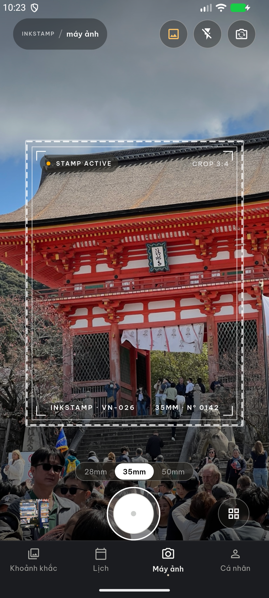
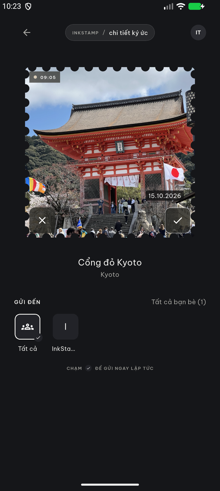
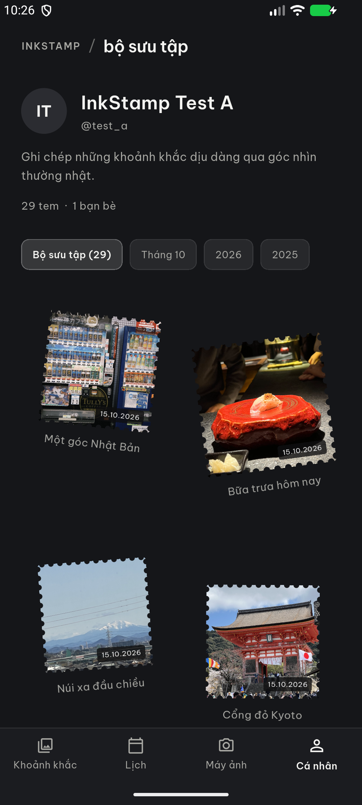
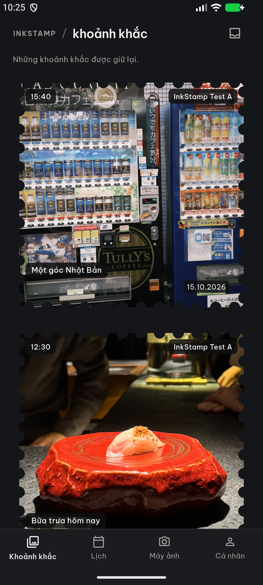
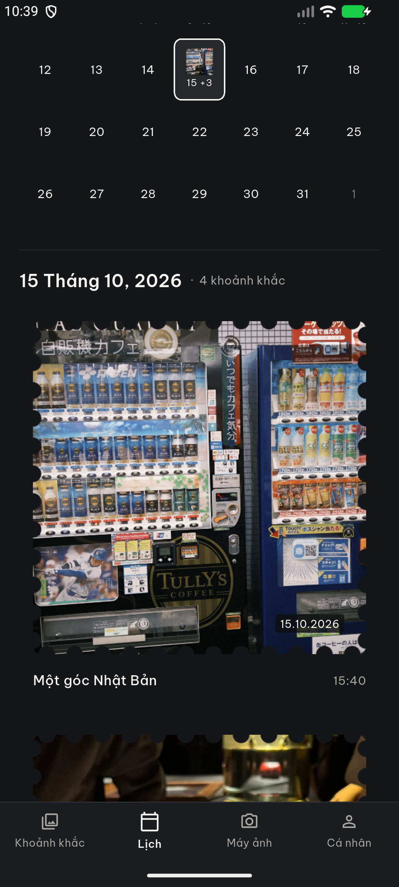
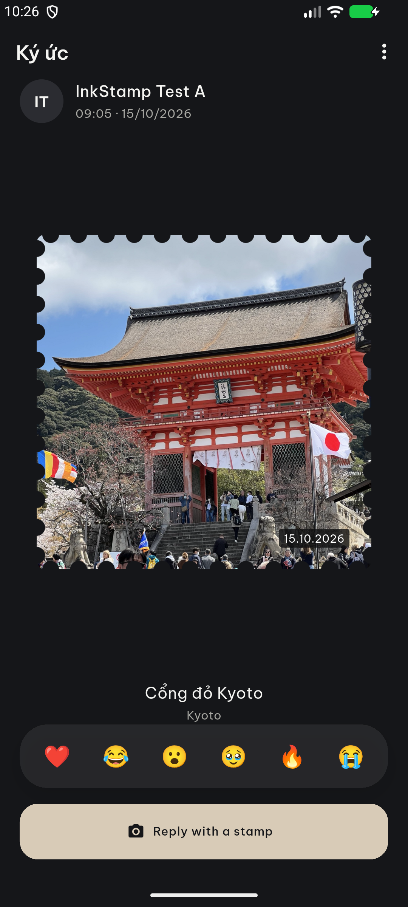

# InkStamp

Biến những khoảnh khắc thường ngày thành những con tem mà bạn yêu thích.

## Giới thiệu

InkStamp là ứng dụng camera và chia sẻ kỷ niệm được xây dựng bằng Flutter.
Bạn có thể chụp ảnh, biến ảnh thành một con tem, gửi cho bạn bè
và lưu giữ chúng trong lịch hoặc bộ sưu tập cá nhân.

**Chụp ảnh → Tạo tem → Chọn người nhận → Gửi → Lưu giữ kỷ niệm**

## Tính năng

- **Chụp:** ảnh được xử lý thành tem.
- **Chia sẻ với bạn bè:** xem trước ảnh và chọn gửi cho tất cả hoặc từng người bạn.
- **Kết nối bạn bè:** tìm theo username, gửi và phản hồi lời mời, quản lý Close Friends.
- **Hộp thư:** nhận tem, theo dõi trạng thái đã xem, thả cảm xúc và trả lời bằng tem.
- **Lưu giữ kỷ niệm:** xem lại qua History, Calendar và bộ sưu tập trên Profile.

## Giao diện

<p align="center">
  
  
  
</p>

<p align="center">Camera · Xem trước tem · Bộ sưu tập</p>

<details>
  <summary>Xem thêm History, Calendar và Memory Detail</summary>
  <p align="center">
    
    
    
  </p>
</details>


## Công nghệ

- **Mobile:** Flutter, Dart, Riverpod, GoRouter.
- **Backend:** Firebase Auth, Firestore, Cloud Functions với TypeScript.
- **Ảnh:** thư viện Dart `image`, Cloudinary và Cloudflare Worker gateway.
- **Kiểm thử:** Flutter Test, Golden Test, Vitest và Android integration test.

## Quick Start

### 1. Chuẩn bị

Cần Flutter **3.47.1**, Android SDK/emulator, Node.js **22**, Java **21** và Firebase CLI.

Luồng chia sẻ thật cần quyền truy cập Firebase DEV và cấu hình Cloudinary riêng.
Chuẩn bị `google-services.json`, `firebase_options.dart` và `.dev.vars` theo
[hướng dẫn backend DEV](docs/BACKEND_DEV_UNBLOCK.md#dev-configuration).
Các file cấu hình riêng không được đưa vào Git.

### 2. Cài dependencies

```powershell
git clone https://github.com/NNghipp/inkstamp.git
cd inkstamp
npm --prefix functions ci
npm --prefix workers/media-gateway ci
cd apps/mobile
flutter pub get
```

### 3. Khởi động backend và ứng dụng

<details>
  <summary>Backend local — mở hai terminal riêng</summary>

Terminal 1, từ thư mục gốc repository:

```powershell
npm --prefix functions run build
$env:DEV_BACKEND_MODE='functions_emulator'
$env:MEDIA_GATEWAY_BASE_URL='http://127.0.0.1:8787'
firebase emulators:start --only functions --project inkstamp-dev
```

Terminal 2, từ thư mục gốc repository:

```powershell
cd workers/media-gateway
.\node_modules\.bin\wrangler.cmd dev --local --ip 127.0.0.1 --port 8787 --log-level warn --show-interactive-dev-session false
```

</details>

Sau khi backend sẵn sàng, mở terminal thứ ba từ thư mục gốc repository:

```powershell
adb -s emulator-5554 reverse tcp:5001 tcp:5001
adb -s emulator-5554 reverse tcp:8787 tcp:8787
cd apps/mobile
flutter run -d emulator-5554 --dart-define=APP_ENV=dev --dart-define=ENABLE_DEV_TEST_AUTH=true --dart-define=BACKEND_MODE=functions_emulator --dart-define=MEDIA_GATEWAY_BASE_URL=http://127.0.0.1:8787
```

Thay `emulator-5554` nếu thiết bị có ID khác. Luồng đăng nhập A/B phục vụ demo
được cấu hình riêng theo [DEV test authentication](docs/DEV_TEST_AUTH.md).

Functions và gateway chạy local; Auth, Firestore và Cloudinary dùng dịch vụ DEV thật.
Môi trường hiện tại giữ **Firebase Spark**, không cần bật billing hoặc deploy Functions.

Để thử ảnh cá nhân, thêm ảnh vào `apps/mobile/assets/image_test/`, rebuild ứng dụng,
chọn ảnh qua nút **DEV sample capture**, rồi bấm shutter.
[Chi tiết chế độ ảnh mẫu](docs/DEV_SAMPLE_CAPTURE.md).

## Cấu trúc project

```text
inkstamp/
├── apps/mobile/            # Ứng dụng Flutter
│   ├── lib/
│   │   ├── app/            # Router, theme và app shell
│   │   ├── core/           # Cấu hình, widget và tiện ích dùng chung
│   │   └── features/       # Camera, auth, friends, stamps, inbox, archive...
│   ├── assets/             # Font, ảnh thiết kế và ảnh mẫu DEV
│   ├── test/               # Unit, widget và golden tests
│   └── integration_test/   # Kiểm thử trên Android
├── functions/              # Firebase callable Functions và backend tests
├── workers/media-gateway/  # Xác thực quyền truy cập, ký upload/delivery URL
├── firebase/               # Firestore indexes
├── design_ui_ux/           # Thiết kế HTML và ảnh tham chiếu
└── docs/                   # Tài liệu kỹ thuật và bằng chứng kiểm thử
```

## Kiểm thử

Chạy từ thư mục gốc repository sau khi hoàn tất cấu hình DEV:

```powershell
npm --prefix functions test
npm --prefix workers/media-gateway test
cd apps/mobile
flutter analyze
flutter test
```

## Tài liệu

- [Kiến trúc hệ thống](docs/ARCHITECTURE.md)
- [Pipeline xử lý ảnh tem](docs/STAMP_EDGES.md)
- [Backend DEV trên Firebase Spark](docs/BACKEND_DEV_UNBLOCK.md)
- [Bảo mật](SECURITY.md) · [Giấy phép](LICENSE)
