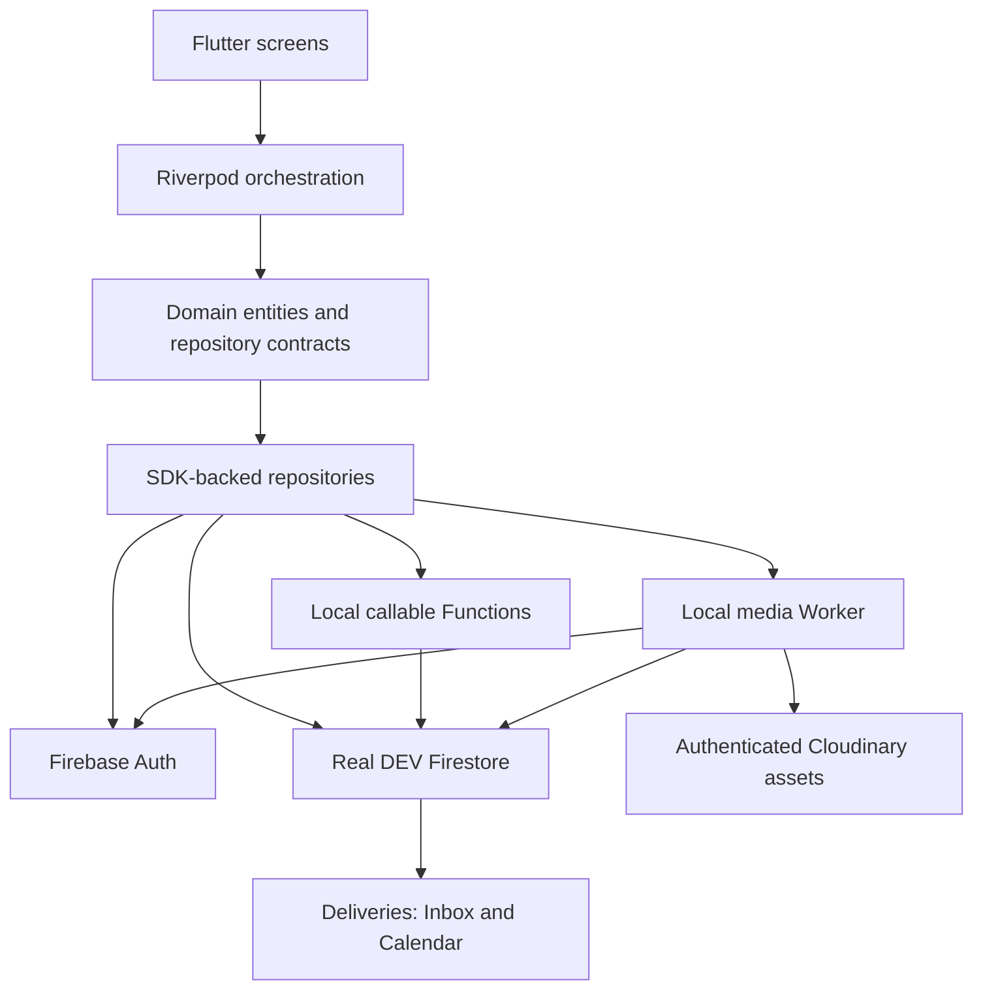
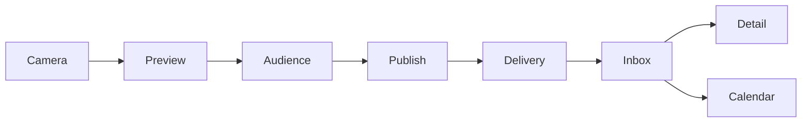

# InkStamp — Portfolio Overview

## Product

InkStamp is a camera-first Android app for sharing small moments as stamp-style photos with friends. A short capture/preview/send flow leads to an unread/read Inbox and a date-based memory archive. The goal is intentional private sharing, not a public feed.

## My Role

Work represented by the repository: Flutter implementation from supplied HTML/PNG references, interaction/state design, feature-first architecture, camera/image processing, Firebase/Cloudflare/Cloudinary integration, automated tests and Android DEV E2E/hardening. This describes scope, not proof of solo authorship or original design ownership. Use first-person CV wording only for contributions you personally made and can explain.

## Architecture

Widgets render state; controllers coordinate capture/drafts/publish. Repository implementations isolate SDKs. Functions own friendship transitions and transactional fan-out; the Worker checks media access and keeps Cloudinary secrets off the app. DEV Auth/Firestore are real services, not local mocks.

Preview/audience/send share one Post-Capture screen. [Standalone diagram sources](portfolio/diagrams/README.md).

## Key Challenges

| Problem | Approach | Verified outcome |
|---|---|---|
| Tab/background changes race with camera init/dispose | Serialize hardware operations; generations and route ownership reject stale completion | 20 rapid transitions and native background/Preview stress PASS |
| Captured files need predictable size/privacy | Correct orientation, square-crop, output 1440×1440 + 512×512, remove EXIF; clean owned files | Real dimensions/metadata/cleanup asserted |
| Server commits but client loses the response | Retain media/audience identity; UUID v5 request and atomic stamp/ledger/delivery transaction | Real response-loss retry yields one stamp/delivery |
| Account changes expose stale async results | UID-scoped providers, generation guards, draft cleanup and image eviction | A/B tests/replay PASS; no forensic cache-erasure claim |
| Date boundaries/cursor ties lose memories | Local-day/month bounds; timestamp + ID value cursor, 25 plus lookahead | 8 pagination tests and real 126-fixture traversal PASS |
| Revoke cannot retract delivered bytes | Deny new URLs, attempt full/thumb deletion, reauthorize/evict app media | Unavailable Detail and old full URL 404 in DEV; privacy remains LIMITED |

## Verified Results

Last verified 2026-10-10–11; documentation packaging does not rerun suites.

| Suite | Result | Purpose |
|---|---|---|
| Flutter | 114/114 PASS | Unit/widget/visual tests |
| DEV-auth | 7/7 PASS | Enabled guards/account isolation |
| Regression | 30/30 PASS | Camera/Post-Capture/golden subset |
| Rules | 7/7 PASS | Access-control boundaries |
| Pagination | 8/8 PASS | Cursor/page correctness |
| Functions | 29/29 PASS | Business policies/idempotency |
| Gateway | 36/36 PASS | Authorization/validation/App Check |
| Analyzer | Clean — 0 issues | Static checks |
| Golden | 5 unchanged | Frozen reference UI |

Overlapping suites are not summed. Functions skips 15 emulator-only cases in its ordinary command; Rules/pagination execute them separately. Real A/B E2E PASS 1/1 covers Friend Graph, custom/ALL capture→publish, Inbox/read/Detail, Calendar, retry, block/unblock and revoke. That replay required Wait on an emulator System UI ANR; later Camera stress passed without intervention. [Dated evidence](evidence/2026-10-10/release-hardening/result.md).

## What I Learned

Engineering takeaways to discuss in your own words: async completion does not prove a screen still owns a resource; a timeout does not prove a publish failed; auth changes must reset UI state and local media references; cursor ties/local-day boundaries need explicit tests; revoking access is not erasing every downloaded copy. Tests and scope are more useful than a “production-ready” label.

## Current Limitations

The debug demo needs local Functions/gateway plus real DEV Firebase/Cloudinary access. Spark retained; no billing/production deployment. Google E2E is DEFERRED; production is NOT READY. CDN/bearer URLs, deletion failures, saved copies and tombstone metadata limit revoke. Process-death drafts, large-scale performance, physical-device accessibility and production App Links remain unverified.

The current tab shell needs a presenter URI helper to enter Friends; no sender-revoke menu is wired in Detail. Backend/route E2E completion is not the same as an unguided public navigation experience.

[Demo guide](RECRUITER_DEMO.md) · [CV descriptions](CV_PROJECT_DESCRIPTION.md) · [Release boundaries](RELEASE_HARDENING.md)
